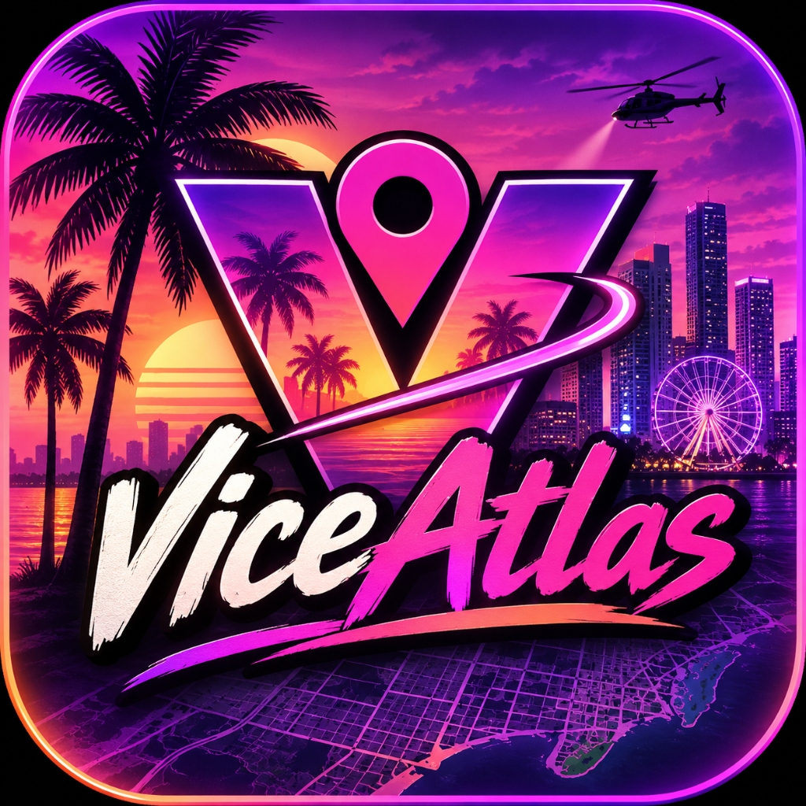
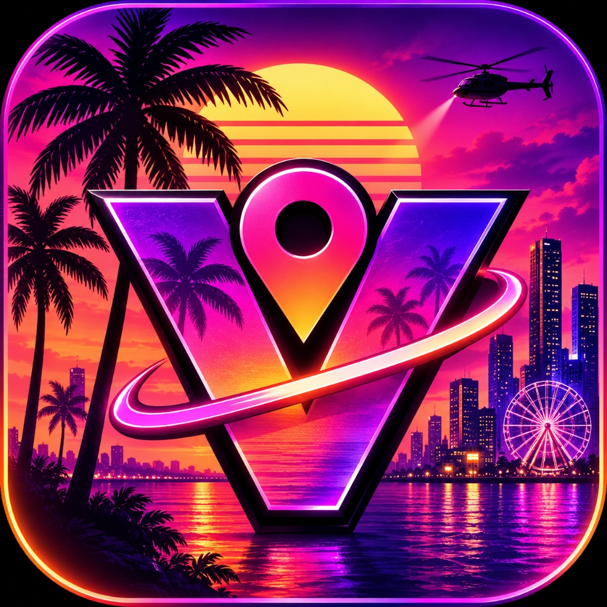

# ViceAtlas — GTA VI (Leonida) İnteraktif Harita & İkinci Ekran Rehberi

**GTA VI (Leonida Eyaleti & Vice City) için 120 FPS GPU hızlandırmalı interaktif harita, 3.754 doğrulanmış konum, 19 sembol kategorisi, SPOILER korumalı Chapter 1–5 hikâye/görev rehberi ve çevrimdışı ilerleme takip uygulaması.**

[-CC46A0?style=for-the-badge)](https://github.com/K3N1903/ViceAtlas)
[-FFA948?style=for-the-badge)](https://github.com/K3N1903/ViceAtlas/raw/main/ViceAtlas-v1.0.0-release.apk)

[-F76685?style=for-the-badge)](https://map.gtadb.org)

---

### 📥 [En Güncel Android APK İndir (`ViceAtlas-v1.0.0-release.apk`)](https://github.com/K3N1903/ViceAtlas/raw/main/ViceAtlas-v1.0.0-release.apk)

---

## 🌴 ViceAtlas Hakkında

**ViceAtlas**, GTA VI oyuncularının Leonida eyaletini (*Vice City, Vice Beach, Leonida Keys, Port Gellhorn, Grassrivers, Ambrosia, Mount Kalaga & Kelly County*) keşfederken ikinci ekran (*Second-Screen Companion*) olarak kullanabilmesi için geliştirilmiş mobil rehber uygulamasıdır.

### ✨ Öne Çıkan Özellikler

- 🗺️ **Tek Güncel Yüksek Çözünürlüklü Leonida Haritası (`Z0–Z6`, `0.5 m/px`)**:
  - Uygulama içinde **515 adet temel harita karosu (`Z0–Z3`)** yerleşik olarak gelir ve internet bağlantısı olmadan anında çalışır.
  - **`Z4` Yüksek Detay Paketi (244 Şehir/Kara Karosu)** uygulama içindeki **Çevrimdışı İndir (Z4)** butonuyla tek dokunuşta cihaza kaydedilebilir.
- ⚡ **120 FPS Tek Geçişli (Single-Pass) GPU Harita Motoru**:
  - Harita karoları ve su damlası (*teardrop*) sembol pinleri doğrudan GPU tuvali üzerinde çizilir; binlerce konum arasında sıfır takılma ile akıcı yakınlaştırma ve kaydırma sağlar.
- 📍 **19 İnteraktif Harita Sembol Kategorisi**:
  - 🏠 Güvenli Ev & Apartman • 🔫 Silah & Cephane • 💎 Rehinci • 🔧 Oto Tamir & Modifiye • ⛽ Benzin İstasyonu • 🏁 Yarış Pisti & Spor • 🍸 Gece Kulübü & Bar • ✈️ Havalimanı & Havacılık • ⚓ Marina & İskele • 🚓 Polis & Kamu • 🏥 Hastane & Sağlık • 👕 Giyim & Berber • 🍔 Restoran & Market • 🏨 Otel & Motel • 📸 Önemli Yapı & Manzara • 🚆 Köprü & Ulaşım • 🏬 Mağaza & Ticaret • 🚪 Girilebilir Bina • 📍 Diğer Konumlar
- 🎛️ **Koleksiyonlar & Çoklu Sembol Kutucukları**:
  - Yana kaydırma gerektirmeyen ızgara filtre kutucukları ile istediğiniz sembol kategorilerini tek dokunuşla aktifleştirip pasifleştirebilirsiniz.
  - Her konumu **Bulundu** veya **Favori** olarak işaretleyebilir, **Kişisel Oyuncu Notu** ekleyebilirsiniz.
- 🛡️ **SPOILER Korumalı Chapter 1–5 Görev Rehberi (97 Görev)**:
  - **Chapter 1 — Just Like Paradise** (22 Görev)
  - **Chapter 2 — Paradise Lost** (13 Görev)
  - **Chapter 3 — Drug Money & Turf** (26 Görev)
  - **Chapter 4 — Vice City, Baby** (25 Görev)
  - **Chapter 5 — Top of the World, Ma** (7 Görev)
  - **Leonida Yan Görevler & Koleksiyonlar** (4 Görev)
  - Kartların üstünde **görevin adı ve bölümü** açıkça yer alır; rehber özeti, **Ödül & Açılan Özellik** rozeti ve **Seçim & Taktik İpucu** rozeti ise **SPOILER** kutusu altında gizlidir. Yalnızca dokunduğunuzda açılır.
- 🔄 **Otomatik Güncelleme Bildirimi & Sürüm Notları**:
  - Yeni bir sürüm yayınlandığında uygulama açılışında otomatik olarak **"Yeni Sürümümüz Yayınlandı! Şimdi Güncelle"** penceresi gösterilir.
  - Güncelleme sonrasında ise yeni sürüme ait **"Güncelleme Notları & Sürüm Bilgisi"** penceresi açılır.

---

## 📲 Kurulum (Android)

1. **[`ViceAtlas-v1.0.0-release.apk`](https://github.com/K3N1903/ViceAtlas/raw/main/ViceAtlas-v1.0.0-release.apk)** bağlantısına tıklayarak en güncel kurulum dosyasını telefonunuza indirin.
2. İndirilen `.apk` dosyasına dokunarak kurulumu tamamlayın.
3. Uygulama içinden **Profil > Güncelleme Kontrol Et** butonuyla veya uygulama açılışında yeni güncellemeleri takip edebilirsiniz.

---

## 👤 Geliştirici & İletişim (Add Me)

- **Geliştirici / GitHub**: [**@K3N1903**](https://github.com/K3N1903)
- **Resmi Dağıtım Deposu**: [https://github.com/K3N1903/ViceAtlas](https://github.com/K3N1903/ViceAtlas)

---

## 📜 Harita ve Veri Kaynakları & Telif Bilgisi

- **Harita & Konum Verileri (CC BY 4.0)**:
  - `GTA VI Map Tiles (CC BY 4.0)` — [https://map.gtadb.org](https://map.gtadb.org)
  - `GTA VI Landmarks Data (CC BY 4.0)` — [https://map.gtadb.org](https://map.gtadb.org)
  - Açık Kaynak Veri Deposu: [https://github.com/rolux/gtadb.org](https://github.com/rolux/gtadb.org) ([CC BY 4.0](https://creativecommons.org/licenses/by/4.0/))
  - *Değişiklik Bildirimi: Orijinal GTADB harita karoları (Z0–Z6) ve konum verileri; ViceAtlas mobil arayüzü, 19 sembol kategorisi sınıflandırması, çevrimdışı önbellekleme ve ikinci ekran rehber sistemi için uyarlanmıştır.*
- **Uygulama & Marka Hakları**:
  - **ViceAtlas** uygulama yazılımı, tasarımı ve derlenmiş paketleri **[@K3N1903](https://github.com/K3N1903)** tarafından geliştirilmiştir. Bu depo yalnızca resmi APK dağıtımı ve sürüm güncelleme bildirimleri (`version.json`) için kullanılmaktadır; uygulama kaynak kodları kapalıdır ve izinsiz kopyalanamaz veya çoğaltılamaz.
  - *ViceAtlas bağımsız, hayran yapımı bir topluluk rehberidir; Rockstar Games veya Take-Two Interactive ile resmi bir bağlantısı yoktur.*
